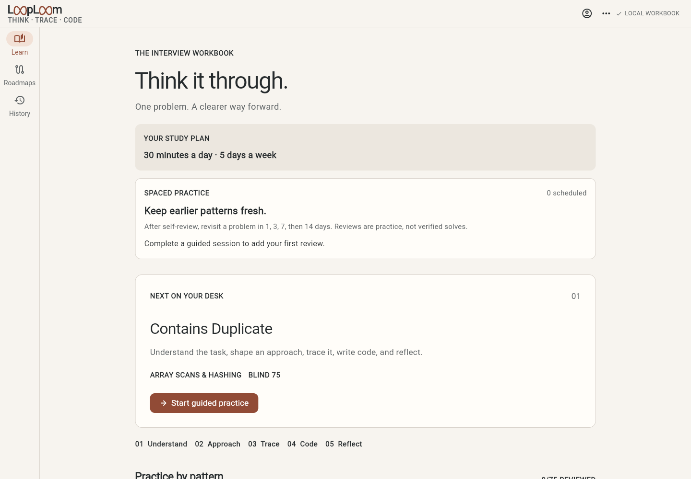
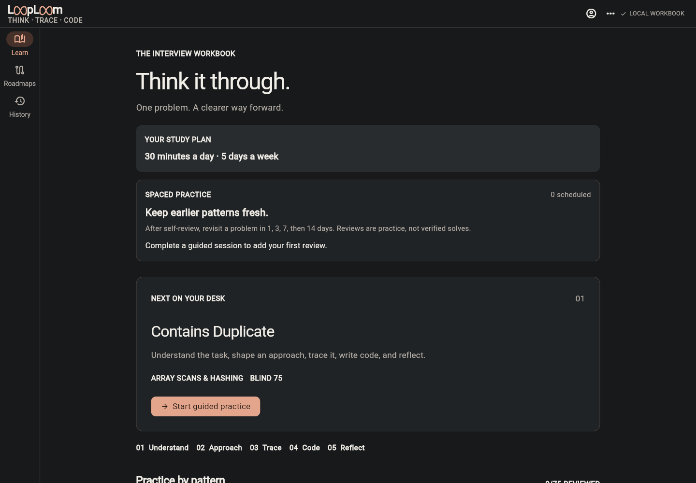

<p align="center">
  
</p>

<p align="center">
  <a href="https://github.com/mkamrul9/LoopLoom"></a>
  <a href="https://github.com/mkamrul9/LoopLoom/network/members"></a>
  <a href="https://github.com/mkamrul9/LoopLoom/issues"></a>
  
  
</p>

<h1 align="center">Think it through. Then write the code.</h1>

<p align="center">
  LoopLoom is a focused coding interview coach that helps you build an approach one decision at a time.
</p>

<table>
  <tr>
    <th align="center">Light</th>
    <th align="center">Dark</th>
  </tr>
  <tr>
    <td></td>
    <td></td>
  </tr>
</table>

## Learn the reasoning, not just the answer

Most practice tools show a problem and wait for a submission. LoopLoom guides you through the thinking that comes first: understand the constraints, explain an algorithm, trace it through an example, write code, and reflect on the tradeoffs.

The coach asks for the next step instead of revealing a complete solution by default. You can request a hint or reveal an explanation when you need one; assisted work is recorded as assisted.

## What is in the app

- **Guided interview practice** across five checkpoints: Understand, Approach, Trace, Code, and Reflect.
- **Interview study paths:** Starter 30, Blind 75, Interview Mastery 300, a one-week prep list, and a last-day review list, organized around interview patterns and phases.
- **Optional starting-point setup** for experience, target role, practice language, time goal, and interview date. An eight-scenario pattern check can refine a suggested path on Home; it does not change the selected roadmap or restrict any path.
- **Feedback and contact** from the app menu or settings, with bug, idea, and question email drafts addressed to `cdkamrul9@gmail.com`. The learner reviews and sends the email in their own mail app.
- **Four coding languages:** C++, Python, JavaScript, and TypeScript, with a saved draft for each language.
- **Reference code for 34 selected problems** in all four languages, hidden until a learner spends 10 local study points to reveal it. This includes the 25-problem one-week path and nine more Blind 75 lessons; the rest of the catalog still needs independently reviewed code.
- **Code availability filter** on Blind 75 and Mastery 300 shows only problems with both reference code and case suites. A private runner is required to execute code; the cases and revealed references can be viewed offline.
- **Runner connection check** in Settings confirms whether the private runner is reachable and which languages are ready before saving its address. The hosted HTTPS PWA cannot call the development HTTP LAN runner; use the Android app or local web preview for that runner.
- **A local workbook** for attempts, notes, saved problems, study goals, and review history. Save or restore JSON backup files on Android and web, with a validated preview before importing; copy/paste remains available.
- **An insight journal** in History collects completed reflections by problem. Add an optional short takeaway after a session and edit it later; both stay in the local workbook and its backup.
- **A small daily practice suggestion** based on unfinished work, due recall, the selected roadmap, the daily time goal, and patterns flagged by the optional quick check.
- **Readable study settings** with an Extra large 1.5× option, device text scaling, and persistent System, Light, and Dark themes.
- **Responsive Flutter screens** for Android and web.
- **Installable web app** with a home-screen icon and an offline app shell. Open the web app once while online, then use the browser menu’s Install app or Add to Home Screen action. Saved practice and the authored offline coach work without a connection; Gemini and external challenge pages still require one.
- **Optional Gemini AI coach** through Firebase AI Logic, enabled only after Firebase and App Check are configured and the learner opts in. It sends bounded text only when requested; no model weights are bundled in the APK. The default checkout has no Firebase project config, so cloud AI is off and guided practice still works offline.
- **Experimental local-model gateway** for development only. The tested small models are not approved for learner feedback.

### How a session works

1. Read the constraints and explain what the problem asks.
2. Describe an approach and why it should work.
3. Trace the approach through an example and an edge case.
4. Write a code draft in your preferred language.
5. State the complexity and reflect on a follow-up.

At each step, save your thinking, review it with the AI coach or the authored offline self-check, then choose to continue or revise. Only the action needed for the current step is prominent; hints remain available. Progress is labeled **self-reviewed**. It does not claim a verified solve when code has not been judged.

## The curriculum, honestly described

LoopLoom writes its own learning prompts, hints, and explanations. The Blind 75 path links to the official challenge pages and is not affiliated with LeetCode. The 300-problem roadmap combines the Blind 75 with additional interview challenges; canonical statements and online judging remain on their linked sites.

The curriculum is still being reviewed. Every problem in the one-week interview track and its last-day subset now has three local reference cases, problem-specific edge cases, and original C++, Python, JavaScript, and TypeScript reference code. Reference code starts hidden and costs 10 of the 10,000 local study points to unlock per problem. These are practice credits, not purchases or a secure payment balance. Other challenges may still need an external judge. The optional self-hosted runner executes authored reference cases in disposable Docker containers; see [phone setup](docs/REFERENCE_RUNNER.md). It is not a public production code-execution service.

## A quiet place to practice

The paper, charcoal, and muted-clay palette keeps problem text and code in focus. Choose System to follow the device, or select Light or Dark in **Profile & settings → Appearance**. Your choice is saved in the local workbook. The two infinity-shaped `oo` pairs are drawn directly into the one-line wordmark and form a compact launcher mark for Android and installed web apps.

## Run locally

### Requirements

- Flutter SDK with Dart 3.12 or newer
- Android SDK for Android builds
- A browser for Flutter web

### Start the app

```bash
cd apps/solveit
flutter pub get
flutter run -d chrome
```

For Android, start an emulator or connect a device, then run:

```bash
flutter run
```

The app stores its workbook locally. There is no sign-in or cloud sync in this release. The Android application ID still uses the original `dev.solveit.solveit` identity to preserve existing local installs.

## Repository map

```text
apps/solveit/       Flutter app, Android project, and web assets
docs/               Product, architecture, curriculum, and release documentation
scripts/            Local development helpers and brand asset generator
```

Useful guides:

- [Product roadmap](docs/PRODUCT_ROADMAP.md)
- [Architecture and data model](docs/ARCHITECTURE.md)
- [UX and visual direction](docs/UX_SPEC.md)
- [LoopLoom brand and color palettes](docs/LOOPLOOM_BRAND.md)
- [Curriculum: Interview Mastery 300](docs/MASTER_300_CURRICULUM.md)
- [Local development and backup](docs/LOCAL_DEVELOPMENT.md)
- [Gemini AI setup and App Check](docs/AI_SETUP.md)
- [Local AI evaluation](docs/LOCAL_AI_VALIDATION.md)
- [Code runner scope](docs/REFERENCE_RUNNER.md)
- [Release and monetization plan](docs/RELEASE_MONETIZATION.md)
- [Google Play release preparation](docs/PLAY_RELEASE.md)
- [Play listing draft](docs/PLAY_STORE_LISTING.md)
- [Public privacy policy](https://looploom-coach-2026.web.app/privacy.html)

## Project status

LoopLoom is under active development. The hosted build has Firebase AI Logic and App Check configured, while a fresh checkout needs its own ignored Firebase configuration; learners must also opt in before sending an answer. Accounts, cross-device sync, production-grade AI evaluation, secure hosted code execution, and billing are not implemented. A separately signed Play upload bundle can be built for internal testing. Public release still needs curriculum review, real-device and accessibility checks, the account owner's Play Console declarations and testing, key recovery backup, and a Play-installed AI/App Check check. See the [delivery roadmap](docs/PRODUCT_ROADMAP.md) for the current plan.

## License

No open-source license has been added yet. Until the project publishes one, public visibility does not grant permission to reuse or distribute the code.
