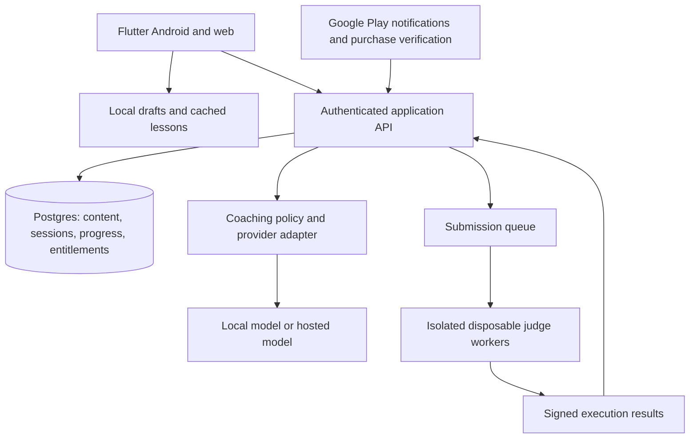

# Architecture

## One product, several replaceable capabilities

Use one Flutter learning client for Android and web, a backend modular monolith, Postgres, and a separate isolated judge worker pool. Keep AI behind a backend adapter. This supports growth without requiring microservices for the pilot.

## Flutter client

Feature-oriented directories: onboarding, learn, roadmaps, coaching, editor, history, review, settings, and purchases. Each feature separates presentation state, domain rules, and data access. Use immutable domain records and repository interfaces. Start with SDK ChangeNotifier view models; adopt a more involved state library only when its benefits justify it. Use declarative routing before shipping deep links/web. [Flutter architecture recommendations](https://docs.flutter.dev/app-architecture/recommendations).

Use adaptive layouts based on available width: compact bottom navigation and a sequential coach/editor flow on phones; a navigation rail and side-by-side workspace on wide screens. Do not depend on `dart:io` in shared domain/UI code. Platform adapters own local storage, connectivity, secure credentials, billing, and optional inference. [Adaptive Flutter guidance](https://docs.flutter.dev/ui/adaptive-responsive).

Current pilot persistence uses Sembast file storage on Android and IndexedDB on web behind SessionRepository. Versioned snapshots retain draft input, notes, checkpoints, assistance, and Focus view. Serialized transactions and optimistic write versions prevent stale tabs from overwriting newer work. Failed saves remain queued with visible status/retry; unsupported records are retained. The database is loaded in memory, so re-evaluate a SQLite adapter as usage/query volume grows. A sync outbox, account isolation, server revisions, and cross-device conflict resolution remain future work.

## Backend

Proposed stack: TypeScript application API plus Postgres; choose a lightweight maintained HTTP framework during implementation. Use managed authentication/Postgres if their quotas, region, and pricing fit the launch audience; avoid depending on a free tier as a permanent cost model. Centralize authorization, request validation, quotas, and audit metadata.

Modules: identity, content, coaching, submissions, progress, review scheduling, entitlements, and operations. Background jobs handle judge polling, billing reconciliation, account deletion, and analytics aggregation. Add Redis/another queue service only when the selected queue strategy needs it.

## Core records

- Profile: user ID, learning level, preferred language, timezone, optional goals. Collect the minimum personal data required.
- Pattern: stable ID, title, prerequisite IDs, explanation, curriculum order.
- ProblemVersion: stable problem ID, version ID, original statement, constraints, visible cases, content provenance, accepted approaches, rubrics, hint ladder, editorial, reference implementations, review status.
- TestBundle: private, versioned visible/hidden cases and checker configuration. Hidden cases and editorials are excluded from ordinary lesson responses.
- Roadmap/RoadmapItem: version, ordered pattern/problem references, level, prerequisites. Each problem ID is counted once in aggregate progress.
- Session: UUID, owner, problem version, stage, mode, language drafts, message sequence, hints/reveal flags, timestamps, revision.
- Feedback: session/message IDs, provider/model/prompt version, rubric evidence, outcome, validated schema, latency/cost metadata.
- Submission: idempotency key, owner, problem/test/runtime versions, source checksum, execution status, resource usage, case summary, judge provenance.
- Progress: attempt references, independent/assisted state, latest verified solve, review date, per-pattern evidence. Never set solved directly from the client.
- Entitlement: account, store/product/purchase identity, active-until, lifecycle state, verification timestamp; never trust an APK-local purchase flag.
- ContentReview: reviewer, tested runtime versions, rubric evaluation results, publish/rollback timestamps.

## API boundary

Initial endpoints: fetch published roadmap/problem metadata; create/resume a session; submit an explanation; request a hint/reveal; save a draft; create/poll a submission; complete a reflection; fetch progress/review queue; verify a purchase; request account export/deletion.

The server checks ownership, valid session transitions, content versions, request size, quota, and idempotency. Use a monotonically increasing revision for concurrent session updates. Return typed errors and a recoverable state. An AI failure must not erase a draft or silently consume unlimited retries.

## Code execution

Implemented development slice: a loopback C++/JavaScript/Python/TypeScript reference runner calls digest-pinned local runtime containers, compares returned values outside the container, and returns per-case statuses. C++ compiles once, then runs all examples in that problem. TypeScript uses Node's erasable-syntax parser without semantic type checks. Runtime readiness is independent and replies are matched to the submitted language. The Flutter client is opt-in, rejects stale/inconsistent replies, and grants no verified progress. This pilot is separate from the proposed authenticated production submission/judge architecture. See [runner boundary](REFERENCE_RUNNER.md).

Treat every learner program as untrusted. Execute in disposable sandboxes with no network, non-root identity, strict CPU/wall time/memory/process/output limits, read-only runtime, and short-lived isolated temporary storage. Use a hardened isolation boundary; ordinary application containers alone are insufficient justification for arbitrary-code safety. Run the judge in a separate network/account from the API and database. Give it no user data, secrets, or general database credentials.

Pin compiler/runtime images, compile TypeScript before execution, and use explicit JSON input/output or generated function harnesses. Define numeric limits so Python integers and JavaScript numbers agree with each problem contract. Compare outputs with problem-specific checkers where order or multiple valid answers matter. Report compile error, runtime error, timeout, memory limit, wrong answer, accepted, and infrastructure failure distinctly.

An accepted result plus the required learning steps may create a verified solve. Store assistance separately. Rate-limit submissions; scan for sandbox escapes in independent security review before public use. Start with a judge provider or a carefully reviewed self-hosted judge if that reduces implementation risk; examine license, isolation, pricing, and data handling before selection.

## AI reliability and privacy

The backend is authoritative for stage transitions. Validate model output, limit allowed feedback actions by stage, and expose no hidden test material. The model does not execute code or grant entitlements. Learner text/code is untrusted input, not policy. Keep private solutions outside ordinary coach context until required; output filtering alone cannot guarantee spoiler prevention.

Redact logs, avoid storing full learner code/prompts in analytics, document model data handling and retention, use TLS, and store tokens with platform-appropriate protection. Provide consent controls for cloud AI, an accessible failure fallback, account deletion, and an operational retention policy. Cache only reusable reviewed hints; do not share personalized conversations across users.

## Quality gates

- Domain tests cover valid/invalid coaching transitions, repeated hints, reveal/assistance accounting, independent solve eligibility, stale revisions, retries, and cross-roadmap counting.
- AI evaluation covers valid alternative algorithms, wrong approaches, ambiguity, negation, pasted instructions, multi-turn drift, and inappropriate full solutions.
- Judge integration tests cover four runtimes, boundary cases, multi-answer checkers, timeouts, excessive output, compilation failures, and isolation failures.
- Product checks cover 360px phone widths, large text, keyboard visibility, screen readers, wide web layout, offline/resume/sync conflicts, and purchase/deletion lifecycle.
- Release CI runs format, analysis, unit/widget/integration checks, web build, and Android release build. Pin toolchains once the project setup is confirmed.

## Scaling triggers

Monitor queue wait time, concurrent submissions, coaching latency, error rates, cost per completed session, database contention, and retention. Add workers before splitting services. Extract coaching or judge orchestration only when their independent scaling/reliability requirements warrant it. Keep content publishing and user entitlements auditable from the start.
